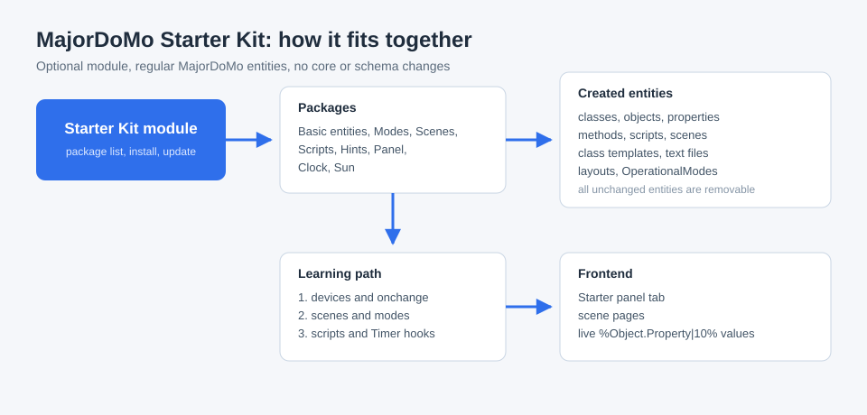
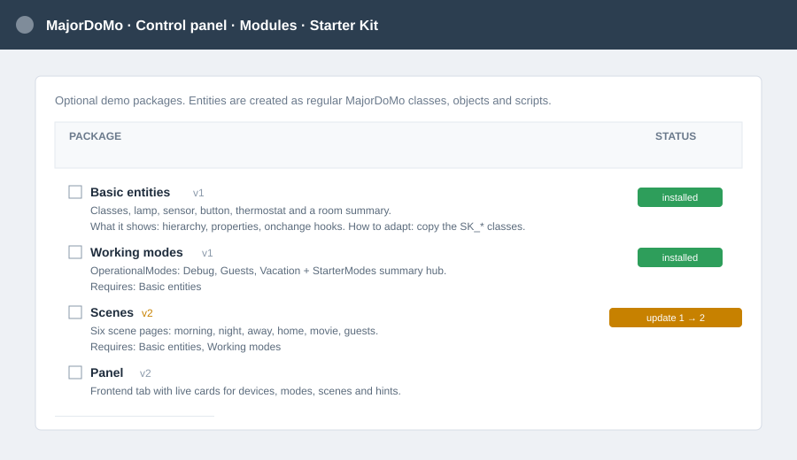
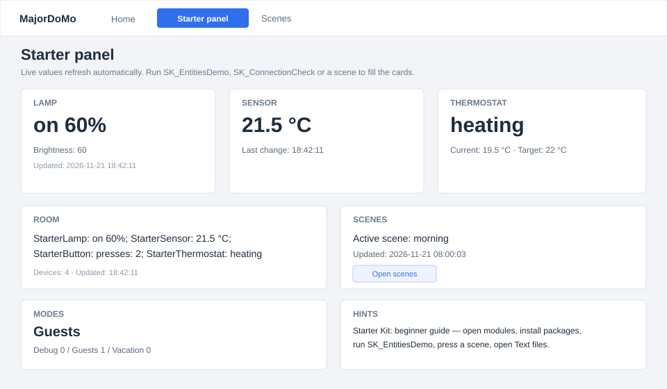

# MajorDoMo Starter Kit

[Русский](README.md) | **English**

Optional MajorDoMo module that installs ready-made example packages into a fresh
system: classes, objects, properties, methods, scripts, scenes, working modes,
frontend pages and text files.



## Why

A fresh MajorDoMo installation is empty, and a beginner does not know where to
start. The core has useful features that are not shown anywhere: `onNewMinute`,
`onNewHour`, `onNewDay`, day parts, sunrise/sunset, twilight, `OperationalModes`
and property `onchange` hooks. Starter Kit demonstrates them together and gives
examples you can adapt.

Beginner guide: [`docs/GUIDE.en.md`](docs/GUIDE.en.md)
([Russian](docs/GUIDE.ru.md)).

## Principles

- No core changes and no database schema changes.
- Only regular MajorDoMo entities: classes, properties, objects, methods,
  scripts, scenes, layouts and text files.
- Nothing is installed automatically: an administrator selects packages on the
  module page.
- Only entities created by this module and left unchanged are removed.
- No MQTT, Telegram, external APIs or real hardware: examples work offline.
- Module localization lives in `modules/starter_kit/lang/`; core dictionaries are
  not modified.

## Installation

```sh
# from the repository root
sudo ./install.sh /var/www
```

Or manually:

1. Copy `modules/starter_kit` to `<MajorDoMo>/modules/`.
2. Copy `templates/starter_kit` to `<MajorDoMo>/templates/`.
3. Set the owner to `www-data:www-data` (Linux).
4. Open **Control panel → Modules → Starter Kit**.
5. Select packages and press **Install selected**.

Dependencies are installed in the right order automatically. MajorDoMo does not
need a restart, but `Timer` subclass objects start receiving `onNewMinute` /
`onNewDay` after `cycle_main` restarts.

### Screenshots and mockups

| Module page | Frontend panel |
|---|---|
|  |  |

These are schematic UI mockups, not screenshots of a specific installation: the
package list and values depend on your system.

## Packages

- **Basic entities** — `SK_Device` → `SK_Lamp` / `SK_Sensor` / `SK_Button` /
  `SK_Thermostat`, `SK_Room`, demo objects, class templates and the
  `SK_EntitiesDemo` script: properties, methods and `onchange` hooks.
- **Clock and chime** — `SK_Clock` / `StarterClock`: current time, quiet hours,
  chime counter, optional `say()`; `onNewMinute`, `onNewHour`, `onNewDay`.
- **Time and sun** — `SK_Sun` / `StarterSun` + `SK_SunTimes`: sunrise, sunset,
  civil/nautical/astronomical twilight and `dayPart`, offline.
- **Working modes** — standard `OperationalModes` objects (`Debug`, `Guests`,
  `Vacation`), the `StarterModes` hub and toggle scripts.
- **Scenes** — six scenes: Good morning, Good night, Away, Home, Movie night,
  Guests. Scene buttons call `StarterScenes` methods.
- **Scripts** — welcome message, offline health check, presence simulation,
  two-slot schedule and a report written to a text file.
- **Hints** — a beginner guide in `cms/texts/starter_kit_hints.txt`, the
  `SK_ShowHints` script and per-package hints on the module page.
- **Panel** — a frontend tab with live cards for devices, room, modes, scenes,
  scripts and hints (`%Object.Property|10%`).

### Working modes

`StarterModes` keeps a summary of active modes. Modes are regular
`OperationalModes` objects, so they appear in the **Working modes** section:

- **Debug** — marks itself active and writes to the log;
- **Guests** — lights off, comfortable heating;
- **Vacation** — lights and heating off.

Toggle them with `SK_ModeDebug`, `SK_ModeGuest`, `SK_ModeVacation`,
`SK_ModesOff`, or the Guests scene.

### Templates and text files

- `SK_*` classes get a standard display template (`classes.TEMPLATE`): for
  example, the lamp shows its status and brightness.
- Text files are created in `cms/texts/` and are visible in
  **Control panel → Text files**.
- `SK_ShowHints` reads the guide and puts it into `StarterHints.text` for the
  panel.
- `SK_Report` writes a report to `cms/texts/starter_kit_report.txt`.

## Versions and updates

Every package has an integer version. The module page shows the installed and
available versions and an **Update selected** button.

Updates are additive and conservative:

- new entities are created;
- missing properties and methods are added to owned classes and objects;
- scripts, layouts and text files are updated only if the user did not edit
  them;
- existing scenes are never rewritten.

Version history: [`CHANGELOG.md`](CHANGELOG.md) and [`RELEASES.md`](RELEASES.md).

## Safety

- Installation aborts if an entity with the same title already exists.
- Re-installing an installed package is a no-op.
- Uninstall skips renamed, extended or edited entities.
- Classes still used by objects or subclasses are never deleted.
- A package cannot be removed while another installed package requires it.
- State, versions and created IDs live in `project_modules.DATA` of the
  `starter_kit` module (serialized `installed` array).

## Compatibility

Built for MajorDoMo alpha (PHP 7.4/8.x, MariaDB/MySQL). The module does not
change the database schema and should survive updates. Tested on alpha `ce7b6f3`.

## Documentation

- [`docs/GUIDE.en.md`](docs/GUIDE.en.md) — beginner guide.
- [`docs/GUIDE.ru.md`](docs/GUIDE.ru.md) — Russian guide.
- [`modules/starter_kit/README.md`](modules/starter_kit/README.md) — package
  format and safety rules.
- [`ROADMAP.md`](ROADMAP.md) — done and next.

## License

MIT — see [`LICENSE`](LICENSE).
