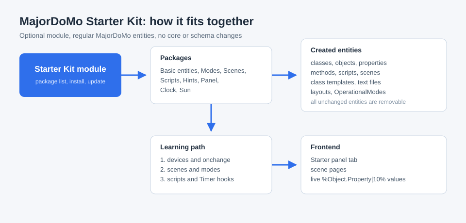
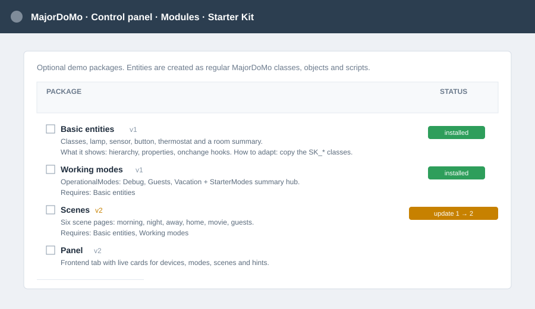
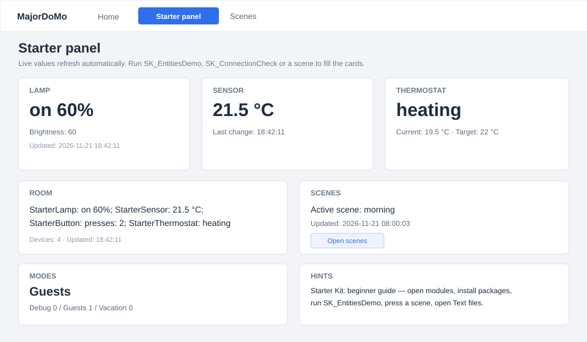

# MajorDoMo Starter Kit

**Русский** | [English](README.en.md)

Необязательный модуль для MajorDoMo, который устанавливает готовые наборы
примеров в свежую систему: классы, объекты, свойства, методы, скрипты, сцены,
режимы работы, страницы фронтенда и текстовые файлы.



## Зачем

Новичок после установки MajorDoMo видит пустую систему и не знает, с чего
начать. В ядре есть полезные возможности, которые нигде не показаны:
`onNewMinute`, `onNewHour`, `onNewDay`, время суток, рассвет/закат, сумерки,
`OperationalModes`, `onchange`-хуки. Starter Kit показывает их в связке и даёт
примеры, которые можно менять под себя.

Подробный гайд для начинающих: [`docs/GUIDE.ru.md`](docs/GUIDE.ru.md)
([English](docs/GUIDE.en.md)).

## Принципы

- Никаких изменений ядра и схемы БД.
- Только штатные сущности MajorDoMo: классы, свойства, объекты, методы, скрипты,
  сцены, layouts, текстовые файлы.
- Ничего не ставится автоматически: администратор выбирает пакеты на странице
  модуля.
- Удаляется только созданное модулем и не изменённое пользователем.
- Без MQTT, Telegram, внешних API и реального железа — примеры работают оффлайн.
- Локализация модуля — в `modules/starter_kit/lang/`, словари ядра не трогаются.

## Установка

```sh
# из корня этого репозитория
sudo ./install.sh /var/www
```

Или вручную:

1. Скопировать `modules/starter_kit` в `<MajorDoMo>/modules/`.
2. Скопировать `templates/starter_kit` в `<MajorDoMo>/templates/`.
3. Выставить владельца `www-data:www-data` (Linux).
4. Открыть **Панель управления → Модули → Starter Kit**.
5. Выбрать пакеты и нажать «Установить выбранные».

Порядок зависимостей соблюдается автоматически. Модуль не требует перезапуска
MajorDoMo, но объекты-наследники `Timer` начнут получать `onNewMinute` /
`onNewDay` после перезапуска `cycle_main`.

### Скриншоты и схемы

| Страница модуля | Панель на фронтенде |
|---|---|
|  |  |

Это схематичные макеты интерфейса, а не снимки конкретной установки: состав
пакетов и значения зависят от вашей системы.

## Пакеты

- **Basic entities** — `SK_Device` → `SK_Lamp` / `SK_Sensor` / `SK_Button` /
  `SK_Thermostat`, `SK_Room`, демо-объекты, шаблоны классов и скрипт
  `SK_EntitiesDemo`: свойства, методы, `onchange`-связки.
- **Clock and chime** — `SK_Clock` / `StarterClock`: текущее время, тихие часы,
  счётчик ударов, опциональное `say()`; `onNewMinute`, `onNewHour`, `onNewDay`.
- **Time and sun** — `SK_Sun` / `StarterSun` + `SK_SunTimes`: рассвет, закат,
  гражданские/навигационные/астрономические сумерки и `dayPart` оффлайн.
- **Working modes** — объекты штатного класса `OperationalModes` (`Debug`,
  `Guests`, `Vacation`), хаб `StarterModes` и скрипты переключения.
- **Scenes** — шесть сцен: Доброе утро, Доброй ночи, Ушли, Пришли, Кино, Гости.
  Кнопки сцен вызывают методы `StarterScenes`.
- **Scripts** — приветствие, офлайн-проверка, имитация присутствия, расписание
  на два слота и отчёт в текстовый файл.
- **Hints** — гайд для начинающих в `cms/texts/starter_kit_hints.txt`, скрипт
  `SK_ShowHints` и подсказки по каждому пакету на странице модуля.
- **Panel** — вкладка фронтенда с живыми карточками устройств, комнаты,
  режимов, сцен, скриптов и подсказок (`%Object.Property|10%`).

### Режимы работы

`StarterModes` собирает сводку активных режимов. Режимы — обычные объекты
`OperationalModes`, поэтому их видно в разделе **Режимы работы**:

- **Debug** — помечает себя активным и пишет в лог;
- **Guests** — свет выключает, отопление держит комфортным;
- **Vacation** — свет и отопление выключает.

Переключение: скрипты `SK_ModeDebug`, `SK_ModeGuest`, `SK_ModeVacation`,
`SK_ModesOff` или сцена «Гости».

### Шаблоны и текстовые файлы

- Классы `SK_*` получают штатный шаблон отображения (`classes.TEMPLATE`):
  например, лампа показывает статус и яркость.
- Текстовые файлы создаются в `cms/texts/` и видны в
  **Панель управления → Текстовые файлы**.
- `SK_ShowHints` читает гайд и складывает его в `StarterHints.text` для панели.
- `SK_Report` пишет отчёт в `cms/texts/starter_kit_report.txt`.

## Версии и обновления

Каждый пакет имеет целочисленную версию. Страница модуля показывает
установленную и доступную версии и кнопку **«Обновить выбранные»**.

Обновления аддитивные и осторожные:

- новые сущности добавляются;
- новым классам и объектам добавляются недостающие свойства и методы;
- скрипты, макеты и текстовые файлы обновляются, только если пользователь их не
  менял;
- существующие сцены не перезаписываются.

История версий — в [`CHANGELOG.md`](CHANGELOG.md) и [`RELEASES.md`](RELEASES.md).

## Безопасность

- Установка прерывается, если сущность с таким именем уже существует.
- Повторная установка уже установленного пакета — no-op.
- Удаление пропускает переименованные, дополненные и изменённые сущности.
- Классы, у которых есть объекты или наследники, не удаляются.
- Пакет нельзя удалить, пока от него зависит другой установленный пакет.
- Состояние, версии и ID созданного хранятся в `project_modules.DATA` модуля
  `starter_kit` (сериализованный массив `installed`).

## Совместимость

Разработано под MajorDoMo alpha (PHP 7.4/8.x, MariaDB/MySQL). Модуль не меняет
схему БД и должен работать на обновлениях. Проверялось на alpha `ce7b6f3`.

## Документация

- [`docs/GUIDE.ru.md`](docs/GUIDE.ru.md) — гайд для начинающих.
- [`docs/GUIDE.en.md`](docs/GUIDE.en.md) — English guide.
- [`modules/starter_kit/README.ru.md`](modules/starter_kit/README.ru.md) —
  формат пакетов и правила безопасности.
- [`ROADMAP.md`](ROADMAP.md) — что сделано и что дальше.

## Лицензия

MIT — см. [`LICENSE`](LICENSE).
