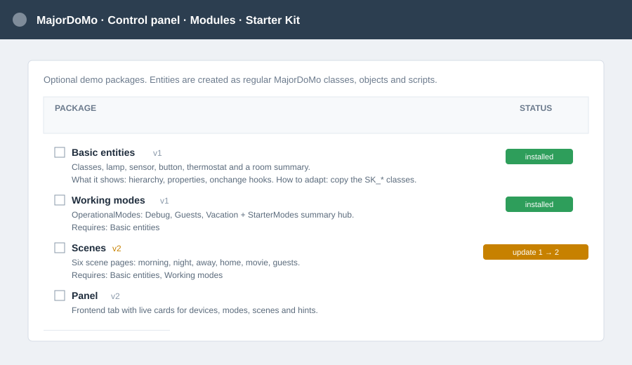
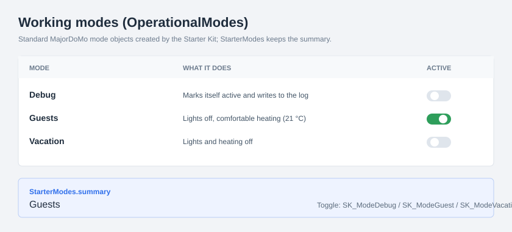
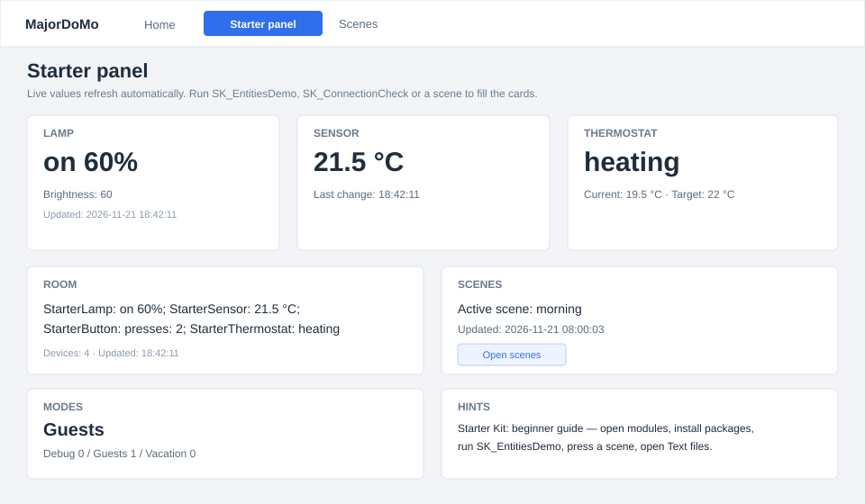

# Starter Kit: beginner guide

**English** | [Русский](GUIDE.ru.md)

This guide takes you from an empty MajorDoMo to working examples: devices,
scenes, modes, scripts and a panel. The images are schematic UI mockups, not
screenshots of a specific installation.

## Requirements

- MajorDoMo alpha (PHP 7.4/8.x, MariaDB/MySQL).
- SSH access and `sudo`.
- 10–15 minutes. Everything is virtual: no real hardware is needed.

## Step 0. Backup

Before changing anything:

```sh
sudo tar czf ~/majordomo-backup-$(date +%F).tar.gz /var/www
```

If possible, also make a database dump in **Control panel → Backup**.

## Step 1. Install the module

From the repository root:

```sh
sudo ./install.sh /var/www
```

The script copies `modules/starter_kit` and `templates/starter_kit` and sets the
owner to `www-data`. No MajorDoMo restart is needed.

## Step 2. Module page

Open **Control panel → Modules → Starter Kit**.



The page shows:

- packages, versions and dependencies;
- **What it shows** and **How to adapt** hints;
- status: installed / not installed / update available.

## Step 3. Install packages

Select packages and press **Install selected**. Dependencies are installed in the
right order automatically. Recommended first run:

1. Basic entities
2. Working modes
3. Scenes
4. Scripts
5. Hints
6. Panel

Clock and chime and Time and sun can be added separately; they have no
dependencies.

## Step 4. First things to try

1. **Scripts → SK_EntitiesDemo** — walks through the lamp, sensor, button and
   thermostat and updates the room summary.
2. **Scripts → SK_ConnectionCheck** — checks the database, `config.php` and the
   main cycle without internet access.
3. **Scenes** — open a scene page and press its button. For example, Good morning
   turns the lamp on and warms the room.
4. **Scripts → SK_PresenceOn** — enables presence simulation (off by default).
5. **Scripts → SK_ShowHints** — loads this guide into the panel.

## Step 5. Working modes

The standard **Working modes** section (`OperationalModes`) is filled with three
objects:



- **Debug** — marks itself active and writes to the log.
- **Guests** — lights off, comfortable heating.
- **Vacation** — lights and heating off.

Toggle them with:

- scripts `SK_ModeDebug`, `SK_ModeGuest`, `SK_ModeVacation`, `SK_ModesOff`;
- the Guests scene.

The summary of active modes is stored in `StarterModes.summary` and shown on the
panel.

## Step 6. Frontend panel

Open the MajorDoMo home page. A **Starter panel** tab appears:



The cards use regular `%Object.Property|10%` placeholders: values refresh over
websockets, or by AJAX when websockets are disabled.

## Step 7. Templates and text files

- **Class templates**: `SK_Lamp`, `SK_Sensor`, `SK_Thermostat`, `SK_Room` and
  `SK_Modes` have `TEMPLATE` filled in. Open an object and you will see a line
  like `StarterLamp: on 60%`.
- **Text files**: **Control panel → Text files**.
  - `starter_kit_hints.txt` — this guide; edit it freely.
  - `starter_kit_report.txt` — appears after running `SK_Report`.
- `SK_ShowHints` reads the guide and updates `StarterHints.text`.

## Step 8. Updates

When a newer package version appears in the repository, the module page shows an
**update available** badge and an **Update selected** button.

What an update does:

- adds new entities;
- adds missing properties and methods;
- updates scripts, layouts and text files only if you did not edit them;
- never rewrites existing scenes.

Edited entities are kept and reported.

## Step 9. Uninstall

1. Remove dependent packages first: Panel, then Scenes/Scripts/Hints/Modes, then
   Basic entities.
2. Edited objects, classes, scenes, pages and files are kept: this protects your
   work.
3. Full reset: uninstall the package and install it again.

## Troubleshooting

**The module is not in the list.**
Check permissions: `modules/starter_kit` and `templates/starter_kit` must belong
to `www-data:www-data`, directories 755, files 644.

**The panel is empty.**
Run `SK_EntitiesDemo`, `SK_ConnectionCheck`, `SK_ShowHints` and one of the
scenes.

**Presence or schedule does nothing.**
They are `Timer` subclasses. Restart the cycles after installation:

```sh
sudo systemctl restart majordomo
```

**A scene does not work.**
Make sure Basic entities is installed and the scene calls `StarterScenes`. Logs:
`cms/debmes/YYYY-MM-DD/starter_kit.log`.

**An update skipped an entity.**
You edited it. This is expected: uninstall and reinstall the package if you want
the reference version back.

## Next steps

- Change `StarterSun` coordinates to your city.
- Add your objects to `StarterRoom.deviceList`.
- Create your own mode: an object of class `OperationalModes`.
- Create your own scene: a `button` element calling a method of your object.
- Reuse `SK_ConnectionCheck` in your monitoring.

Docs: [`../README.en.md`](../README.en.md),
[`../modules/starter_kit/README.md`](../modules/starter_kit/README.md).
