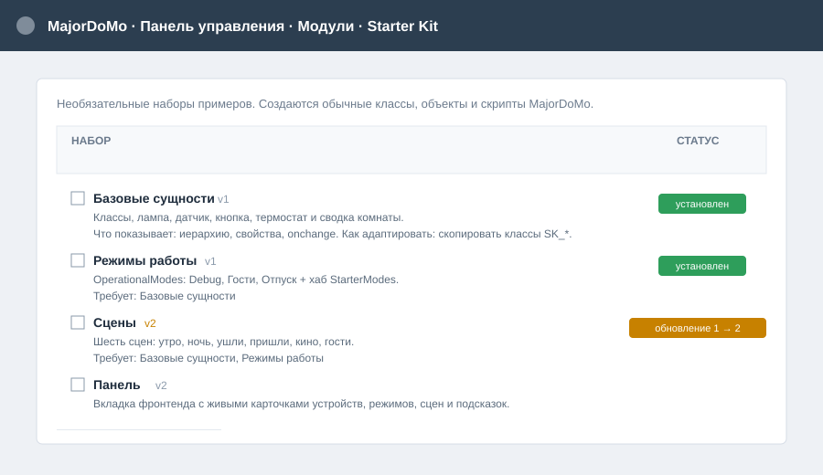
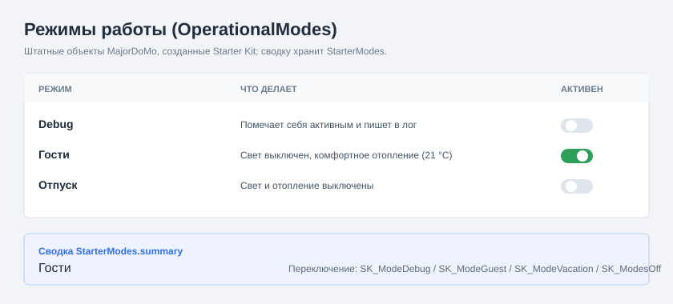
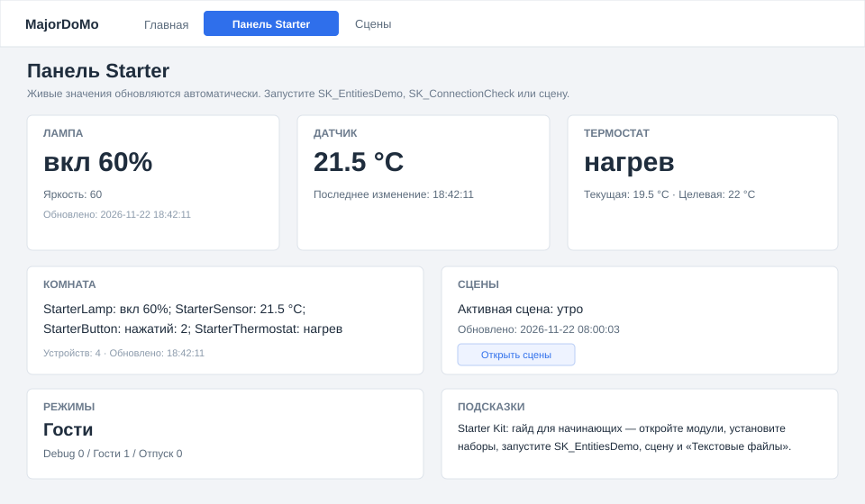

# Starter Kit: гайд для начинающих

[English](GUIDE.en.md) | **Русский**

Этот гайд проведёт от пустой MajorDoMo до работающих примеров: устройства,
сцены, режимы, скрипты и панель. Все схемы ниже — макеты интерфейса, а не
снимки конкретной установки.

## Что понадобится

- MajorDoMo alpha (PHP 7.4/8.x, MariaDB/MySQL).
- Доступ к серверу по SSH и права `sudo`.
- 10–15 минут и понимание, что всё виртуальное: реальное железо не нужно.

## Шаг 0. Резервная копия

Перед любыми изменениями:

```sh
sudo tar czf ~/majordomo-backup-$(date +%F).tar.gz /var/www
```

Если есть возможность — сделайте дамп базы через **Панель управления → Резервное
копирование**.

## Шаг 1. Установка модуля

Из корня этого репозитория:

```sh
sudo ./install.sh /var/www
```

Скрипт копирует `modules/starter_kit` и `templates/starter_kit` и выставляет
владельца `www-data`. Перезапуск MajorDoMo не нужен.

## Шаг 2. Страница модуля

Откройте **Панель управления → Модули → Starter Kit**.



На странице видно:

- список наборов, версии и зависимости;
- подсказки «Что показывает» и «Как адаптировать»;
- статус: установлен / не установлен / доступно обновление.

## Шаг 3. Установка наборов

Отметьте наборы и нажмите **«Установить выбранные»**. Зависимости ставятся
автоматически в правильном порядке. Рекомендуемый набор для первого раза:

1. Basic entities
2. Working modes
3. Scenes
4. Scripts
5. Hints
6. Panel

Clock and chime и Time and sun можно добавить отдельно — они ни от чего не
зависят.

## Шаг 4. Первые действия

1. **Скрипты → SK_EntitiesDemo** — прокрутит лампу, датчик, кнопку и термостат,
   обновит сводку комнаты.
2. **Скрипты → SK_ConnectionCheck** — проверит базу, `config.php` и основной цикл
   без интернета.
3. **Сцены** — откройте страницу сцены и нажмите кнопку. Например, «Доброе утро»
   включает лампу и прогревает комнату.
4. **Скрипты → SK_PresenceOn** — включит имитацию присутствия (по умолчанию она
   выключена).
5. **Скрипты → SK_ShowHints** — загрузит этот гайд в панель.

## Шаг 5. Режимы работы

Раздел **Режимы работы** (`OperationalModes`) заполнен тремя объектами:



- **Debug** — помечает себя активным и пишет в лог.
- **Гости** — выключает свет и держит комфортное отопление.
- **Отпуск** — выключает свет и отопление.

Переключение:

- скрипты `SK_ModeDebug`, `SK_ModeGuest`, `SK_ModeVacation`, `SK_ModesOff`;
- сцена «Гости».

Сводка активных режимов хранится в `StarterModes.summary` и видна на панели.

## Шаг 6. Панель на фронтенде

Откройте главную страницу MajorDoMo. Появится вкладка **«Панель Starter»**:



Карточки используют штатные подстановки `%Object.Property|10%`: значения
обновляются через websockets или по AJAX, если websockets отключены.

## Шаг 7. Шаблоны и текстовые файлы

- **Шаблоны классов**: у `SK_Lamp`, `SK_Sensor`, `SK_Thermostat`, `SK_Room` и
  `SK_Modes` заполнено поле `TEMPLATE`. Откройте объект — вы увидите строку вида
  «StarterLamp: вкл 60%».
- **Текстовые файлы**: **Панель управления → Текстовые файлы**.
  - `starter_kit_hints.txt` — этот гайд, его можно править.
  - `starter_kit_report.txt` — появится после запуска `SK_Report`.
- Скрипт `SK_ShowHints` читает гайд и обновляет `StarterHints.text`.

## Шаг 8. Обновления

Когда в репозитории появляется новая версия набора, на странице модуля
появляется метка **«доступно обновление»** и кнопка **«Обновить выбранные»**.

Что делает обновление:

- добавляет новые сущности;
- добавляет недостающие свойства и методы;
- обновляет скрипты, макеты и текстовые файлы, только если вы их не меняли;
- существующие сцены не перезаписывает.

Изменённые сущности остаются как есть, о них будет сообщение.

## Шаг 9. Удаление

1. Сначала удалите зависимые наборы: Panel, затем Scenes/Scripts/Hints/Modes,
   потом Basic entities.
2. Изменённые объекты, классы, сцены, страницы и файлы останутся — это защита от
   потери ваших правок.
3. Полный сброс: удалить набор и установить заново.

## Типовые проблемы

**Модуль не появился в списке.**
Проверьте права: `modules/starter_kit` и `templates/starter_kit` должны
принадлежать `www-data:www-data`, каталоги 755, файлы 644.

**Панель пустая.**
Запустите `SK_EntitiesDemo`, `SK_ConnectionCheck`, `SK_ShowHints` и одну из сцен.

**Присутствие/расписание не срабатывают.**
Это объекты-наследники `Timer`. После установки перезапустите циклы:

```sh
sudo systemctl restart majordomo
```

**Сцена не работает.**
Проверьте, что установлен Basic entities и в сцене указан объект
`StarterScenes`. Логи: `cms/debmes/YYYY-MM-DD/starter_kit.log`.

**Обновление пропустило сущность.**
Значит, вы её меняли. Это ожидаемо: удалите набор и установите заново, если
хотите вернуть эталон.

## Что дальше

- Поменяйте координаты у `StarterSun` под свой город.
- Добавьте свои объекты в `StarterRoom.deviceList`.
- Напишите свой режим: объект класса `OperationalModes`.
- Сделайте свою сцену: элемент `button` с вызовом метода вашего объекта.
- Скопируйте `SK_ConnectionCheck` в свой мониторинг.

Документация: [`../README.md`](../README.md),
[`../modules/starter_kit/README.ru.md`](../modules/starter_kit/README.ru.md).
